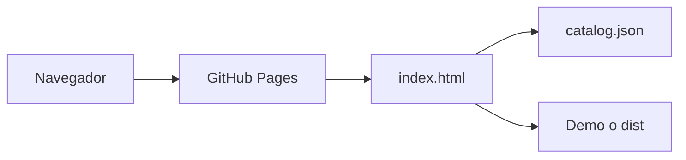

# Cómo funciona este proyecto

Esta guía es para estudiar el repositorio. No forma parte de la web: `docs/` se excluye al publicar. En GitHub se lee aquí: [docs/como-funciona.md](https://github.com/aleroses/Components/blob/master/docs/como-funciona.md).

La web publicada está en https://aleroses.github.io/Components/.

## Qué es

El repositorio guarda experimentos pequeños de HTML, CSS y JavaScript, más dos apps de React (`square` y `changelanguage`). No hay servidor propio ni base de datos. El navegador pide archivos y GitHub Pages los entrega tal cual.

El índice de la raíz no es una de esas demos. Es un catálogo: lista las páginas, las agrupa y deja ver una sin salir de la lista.



## Las piezas del catálogo

Cuatro archivos de la raíz arman el índice. El resto de carpetas son las demos.

| Archivo | Papel |
| --- | --- |
| `index.html` | La página. Tiene el título, el botón de tema, el hueco de la lista y el panel de la demo. |
| `catalog.css` | Colores, lista, panel de escritorio y modal de teléfono. |
| `catalog.js` | Lee el inventario, pinta las tarjetas y abre la demo elegida. |
| `catalog.json` | Una entrada por demo: `path`, `title` y `group`. |

`catalog.js` es un módulo (`<script type="module">`). Al arrancar hace `fetch("./catalog.json")`. Con esa lista crea seis grupos, en este orden: Navegación, Contenido, Carruseles, Efectos, Interacción y Apps. Cada tarjeta es un botón. Al pulsarla, un iframe carga `./` más la ruta de esa entrada. El enlace «Abrir en su página» abre esa misma ruta en una pestaña.

La ruta elegida también queda en el hash, por ejemplo `#accordion%2Findex.html`. Así, al recargar, el catálogo vuelve a abrir esa demo. El `+` de nombres como `order+flex` se guarda codificado como `%2B`, porque en una URL un `+` suelto puede significar un espacio.

## Por qué no vale abrir el archivo

Si abres `index.html` con doble clic, la dirección empieza por `file://`. En ese modo el navegador bloquea `fetch` de un módulo local y la lista sale vacía. El mensaje de la página lo dice: hace falta un servidor estático.

Desde la raíz del repo:

```bash
python3 -m http.server 8765
```

Luego abre http://127.0.0.1:8765/. Ese comando no convierte el proyecto en Python. Solo reparte los archivos de la carpeta. El proyecto sigue siendo HTML, CSS y JavaScript, con dos apps de React aparte.

## Escritorio y teléfono

A partir de 801 px de ancho, la página es una cuadrícula. La lista va a la izquierda. A la derecha, un panel fijo muestra la demo. Ese panel no es una ventana nueva.

A 800 px o menos, el panel se esconde. Al elegir una tarjeta pasa a ser un modal (`position: fixed`) por encima de la lista. Se cierra con la X, con el fondo oscuro o con Escape. La X es `close.svg`, pintada como máscara para que tome el color del tema. No hay librería de iconos en el catálogo.

El botón verde de la esquina, `up.svg`, no está dentro del modal ni de la ficha. Aparece al bajar por la lista y hace scroll al inicio. Mientras el modal está abierto, ese botón se oculta.

## Tema, icono de pestaña y memoria

Un script en el `<head>` de `index.html` corre antes de pintar. Lee la clave `catalog-theme` de `localStorage`. Si no hay nada guardado, usa `prefers-color-scheme`. Pone `data-theme="light"` o `data-theme="dark"` en `<html>`. `catalog.css` cambia los colores con esa marca.

El botón «Modo claro» / «Modo oscuro» guarda la elección y la vuelve a aplicar. Solo cambia el catálogo. La demo de dentro del iframe conserva sus propios estilos.

`favicon.svg` es el icono de la pestaña del índice. Cada demo puede tener el suyo, o ninguno.

## Las demos sueltas

Cada experimento es una carpeta con su `index.html`. El catálogo no las reescribe: las carga en el iframe o las abre por su ruta. Los nombres con `+` (`order+flex`, `details+animation`, `slider-4++`, `with-js+`, `with-css+`) se quedan. En la ruta publicada el `+` es literal.

`web-scraping` no está en `catalog.json`. Es un script de Node (`.mjs`) y no tiene página que mostrar.

Algunos buscadores llaman a TMDB con una clave que ya está en esos archivos. El catálogo los lista igual. No añade un backend para esconder esa clave.

## Las dos apps de React

`square` y `changelanguage` no se sirven desde su `index.html` de desarrollo. Ese archivo apunta a `/src/main.jsx`, y esa ruta no existe en Pages. El catálogo apunta a lo ya construido:

- `square/dist/index.html`
- `changelanguage/dist/index.html`

`dist` está en el `.gitignore` de cada app, así que no viaja en git. En local, dentro de cada carpeta:

```bash
npm ci && npm run build
```

Sin ese build, esas dos tarjetas quedan vacías en tu máquina. En GitHub Pages no hace falta subirlo: la Action lo genera en cada publicación.

Las dos usan Vite con `base: './'` en su `vite.config.js`. Las rutas de JS y CSS del build son relativas. Funcionan en http://127.0.0.1:8765/square/dist/ y también en https://aleroses.github.io/Components/square/dist/. Una base absoluta tipo `/` buscaría los archivos en la raíz del dominio (`aleroses.github.io`), no dentro de `/Components/`, y el build se vería en blanco.

## Qué es `.nojekyll`

Es un archivo vacío en la raíz. Su único contenido es existir.

GitHub Pages tiene dos formas de publicar. La que usa este repo es GitHub Actions: se sube una carpeta ya armada y Pages la sirve sin tocarla. En ese modo Jekyll no corre.

La otra forma es «Deploy from a branch». Ahí GitHub, por defecto, pasa el repo por Jekyll antes de publicarlo. Jekyll está pensado para sitios escritos en Markdown. Si lo dejamos actuar sobre este repo:

- trata el proyecto como un sitio Jekyll;
- puede procesar Markdown y otros archivos en vez de copiarlos;
- oculta carpetas y archivos cuyo nombre empieza por `_`.

`.nojekyll` le dice a ese modo: no uses Jekyll, copia los archivos como están. Hoy el origen es Actions, así que el archivo no interviene en el deploy actual. Sigue en el repo por si algún día se cambia el origen a una rama. También viaja dentro del sitio publicado, porque el `rsync` copia la raíz.

No pulses, en Settings → Pages, los botones **Configure** de «GitHub Pages Jekyll» ni de «Static HTML». Crean otro workflow. Este repo ya tiene el suyo.

## Qué es `.github/workflows/pages.yml`

GitHub Actions lee los YAML de `.github/workflows/`. `pages.yml` es el que publica la web. No es una página ni lo abre el navegador. Es la receta que corre en un ordenador de GitHub cuando corresponde.

Se dispara en dos casos:

- un push a la rama `master`;
- a mano, con `workflow_dispatch`, desde la pestaña Actions.

Un push a `dev` no publica. `dev` es la rama de trabajo. La web cambia solo cuando ese trabajo llega a `master`.

El workflow pide tres permisos: leer el repo (`contents: read`), escribir en Pages (`pages: write`) e identificarse para el deploy (`id-token: write`). Si hay dos publicaciones a la vez, `concurrency` cancela la anterior y deja la última.

Hay dos jobs.

### `build`

Corre en `ubuntu-latest`.

1. Baja el commit con `actions/checkout`.
2. Instala Node 22 y guarda la caché de `square/package-lock.json` y `changelanguage/package-lock.json`.
3. En `square`, ejecuta `npm ci && npm run build`.
4. Hace lo mismo en `changelanguage`.
5. Crea la carpeta `_site` y copia ahí el repo con `rsync`. No copia `_site` sobre sí misma, ni `.git`, ni `node_modules`, ni `docs/`. Los `dist` recién generados sí entran, porque en ese momento ya existen en el disco del job, aunque no estén en git.
6. Sube `_site` como artefacto con `actions/upload-pages-artifact`.

`_site` solo vive durante ese job. No es una carpeta del repo.

### `deploy`

Empieza cuando `build` termina bien. Usa el entorno `github-pages` y `actions/deploy-pages` para publicar el artefacto. La URL de este proyecto es https://aleroses.github.io/Components/. La `C` mayúscula es el nombre del repo.

En Settings → Pages, **Source** tiene que ser **GitHub Actions**. Si sigue en «Deploy from a branch», este YAML no es el que publica y, además, no se construyen las dos apps.

La primera vez que se activó Pages, el job `deploy` falló con `404` porque el origen aún no existía. El `build` ya había subido el artefacto. Al repetir solo los jobs fallidos, `deploy` usó ese artefacto y la web quedó en línea. Si vuelve a pasar justo después de activar Pages, el arreglo es el mismo: **Re-run failed jobs** en ese run, no crear otro workflow.

## Qué entra en la web y qué no

Entra todo lo que `rsync` copia, más los `dist` construidos en el job: el índice, `catalog.json`, el CSS, el JS, los SVG, `.nojekyll` y cada demo.

No entra:

- `docs/`. Esta guía se lee en GitHub, no en la web.
- `.git` y `node_modules`.
- `TASKS.md` y `.cursor/`. Están en `.git/info/exclude`, que solo afecta a esta máquina. No van en los commits y tampoco existen para GitHub. La lista de tareas y las reglas del editor no forman parte del sitio.

`README.md` sí se copia, como cualquier otro archivo de la raíz. Pages no lo convierte en la portada. La portada es `index.html`. En GitHub, el README se muestra en la página del repositorio.

## De un cambio local a la web

1. Trabajas y haces commit en `dev`. Ese commit no toca https://aleroses.github.io/Components/.
2. Para publicar, `dev` se incorpora a `master` y `master` se sube. El push, no el commit, dispara `pages.yml`.
3. Si el cambio está solo en `docs/`, el workflow igual corre al llegar a `master`, pero la guía no aparece en la web. El sitio se vuelve a armar igual que antes.
4. Cuando `deploy` está en verde, la web ya tiene el commit. La primera respuesta puede tardar un minuto. Si ves la versión vieja, recarga sin caché: Pages marca los archivos con `max-age=600`.

Comandos, desde la raíz del repo, con `dev` ya commiteada:

```bash
git checkout master
git merge dev
git push origin master
git checkout dev
```

`git merge dev` aquí solo avanza `master`, porque `dev` sale de `master` y `master` no tiene commits propios. `git push origin master` es el paso que pone en marcha la Action. El último comando vuelve a dejar el trabajo en `dev`.

En la pestaña Actions, el run se llama **Deploy GitHub Pages**. Tiene que quedar en verde el job `build` y el job `deploy`. El sitio queda en https://aleroses.github.io/Components/.
